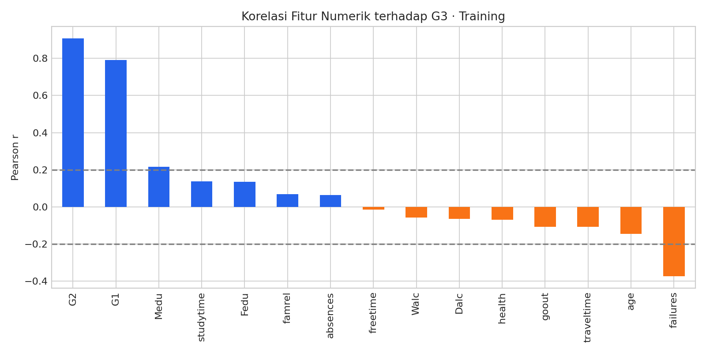
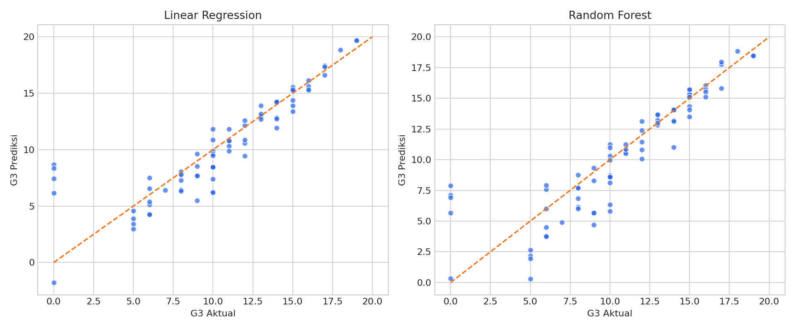

<div align="center">

# 🎓 Student Grade Prediction
### Prediksi Nilai Akhir Siswa · Data Mining Project


**395 siswa · 33 atribut · 3 model · 1 target: G3**

*Dari eksplorasi data akademik hingga evaluasi prediksi nilai akhir.*

</div>

---

## Overview

Proyek mata kuliah **Penggalian Data** untuk memprediksi nilai akhir Matematika siswa menggunakan nilai periode sebelumnya dan faktor akademik. Eksperimen membandingkan **Linear Regression** dan **Random Forest Regressor**, dengan **Dummy Regressor** sebagai pembanding sederhana.

Notebook mencakup eksplorasi data, pemeriksaan kualitas, seleksi fitur numerik, pelatihan, dan evaluasi pada data uji. Dataset tersedia di repositori sehingga analisis dapat berjalan tanpa mengunduh data ulang.

## Highlights

- 📊 Eksplorasi distribusi G3 dan boxplot atribut numerik.
- 🔍 Pemeriksaan missing value dan duplikasi.
- 🧠 Seleksi fitur berdasarkan korelasi pada data training.
- ⚙️ Pipeline StandardScaler + Linear Regression.
- 🌲 Perbandingan Random Forest dengan 300 pohon.
- 📈 Evaluasi RMSE, MAE, R², dan visualisasi nilai aktual vs prediksi.
- 📁 Ekspor metrik dan prediksi untuk seluruh 79 siswa pada data uji.

## Dataset

Menggunakan **Student Performance** dari [UCI Machine Learning Repository](https://archive.ics.uci.edu/dataset/320/student+performance), khusus subset Matematika (`student-mat.csv`).

| Komponen | Detail |
|---|---|
| Sampel analisis | 395 siswa dari dua sekolah di Portugal |
| Kolom | 33: 32 kandidat input dan target G3 |
| Target | Nilai akhir `G3`, rentang 0–20 |
| Missing value / duplikasi | 0 / 0 |
| Training / testing | 316 / 79 siswa (80:20) |
| Random state | 42 |

Subset bahasa Portugis (`student-por.csv`) disertakan sebagai data sumber, tetapi tidak digunakan pada eksperimen ini.

## Workflow

1. Memuat dataset lokal dan memeriksa kualitas data.
2. Mengeksplorasi distribusi nilai serta atribut numerik.
3. Membagi data menjadi training dan testing.
4. Menghitung korelasi fitur numerik terhadap G3 **hanya pada training**.
5. Memilih fitur dengan **|r| ≥ 0,2**.
6. Melatih model; StandardScaler di-fit pada training melalui Pipeline.
7. Mengevaluasi prediksi mentah pada testing dan mengekspor hasil.

Atribut kategorikal tidak digunakan dalam eksperimen ini. Outlier dipertahankan; korelasi dipakai sebagai ukuran hubungan statistik, bukan bukti sebab-akibat.

## Selected Features

| Fitur | Makna | Korelasi terhadap G3 pada training |
|---|---|---:|
| `G2` | Nilai periode kedua | 0.908 |
| `G1` | Nilai periode pertama | 0.792 |
| `Medu` | Tingkat pendidikan ibu | 0.216 |
| `failures` | Jumlah kegagalan kelas sebelumnya | -0.374 |



## Model Performance

Hasil pada **holdout 79 siswa**, `test_size=0.2` dan `random_state=42`. Random Forest menggunakan `n_estimators=300`; tidak dilakukan hyperparameter tuning.

| Model | RMSE ↓ | MAE ↓ | R² ↑ |
|---|---:|---:|---:|
| Linear Regression | 2.1299 | 1.2875 | 0.7788 |
| Random Forest | 2.2077 | 1.4435 | 0.7623 |
| Dummy (Mean) | 4.5502 | 3.6459 | -0.0097 |

**Linear Regression mencatat RMSE terendah pada split ini.** MAE sekitar **1,29 poin** menunjukkan rata-rata selisih absolut prediksi terhadap nilai aktual pada skala G3. R² adalah koefisien determinasi, bukan persentase akurasi.

Prediksi dievaluasi tanpa pembulatan atau clipping ke rentang 0–20. Angka pada tabel dibulatkan untuk tampilan; nilai lengkap tersedia di [`model_metrics.csv`](artifacts/model_metrics.csv).



## Project Structure

| Path | Isi |
|---|---|
| [`FINAL_PROJECT_DATA_MINING_218.ipynb`](FINAL_PROJECT_DATA_MINING_218.ipynb) | Notebook lengkap dengan output analisis dan model |
| `data/student-mat.csv` | Dataset Matematika yang digunakan |
| `data/student-por.csv` | Dataset bahasa Portugis dari sumber asli |
| `data/student.txt` | Deskripsi atribut asli |
| `data/student-merge.R` | Skrip pencocokan dataset asli dari UCI |
| `artifacts/` | Grafik, metrik model, dan prediksi data uji |
| `requirements.txt` | Dependensi Python |

## Run Locally

Gunakan **Python 3.11** dan jalankan dari folder utama proyek:

```bash
python -m pip install -r requirements.txt
python -m jupyterlab
```

Buka `FINAL_PROJECT_DATA_MINING_218.ipynb`, kemudian pilih **Run All**. Hasil grafik dan CSV ditulis ke folder `artifacts/`.

## Experiment Scope

Model menggunakan **G1 dan G2 yang sudah tersedia**, sehingga prediksi dilakukan setelah periode kedua. Evaluasi berasal dari satu pembagian data pada dataset kecil; hasilnya belum mencakup cross-validation atau validasi lintas sekolah. G3=0 tetap disertakan dalam analisis.

## Author

**Hanisah Aufa Khalidah**  
NIM: **202310370311218**  
Mata Kuliah: **Penggalian Data**

## Dataset Attribution

Cortez, P. (2008). *Student Performance* [Dataset]. UCI Machine Learning Repository. [doi:10.24432/C5TG7T](https://doi.org/10.24432/C5TG7T).

Dataset didistribusikan dengan lisensi [Creative Commons Attribution 4.0 International (CC BY 4.0)](https://creativecommons.org/licenses/by/4.0/). Data dalam `data/` disalin dari arsip asli tanpa perubahan.
